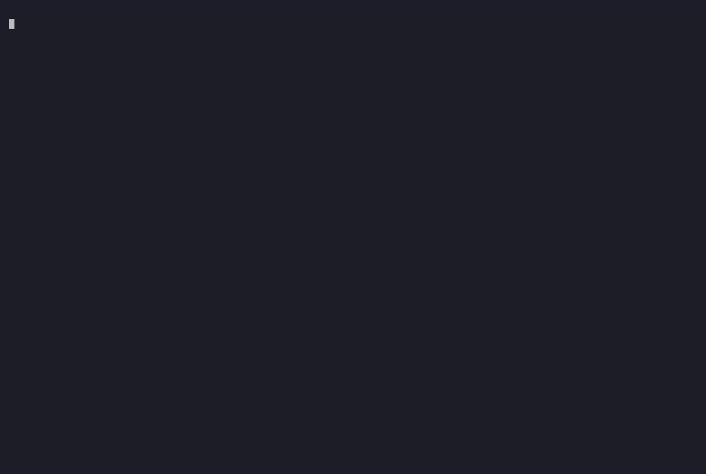
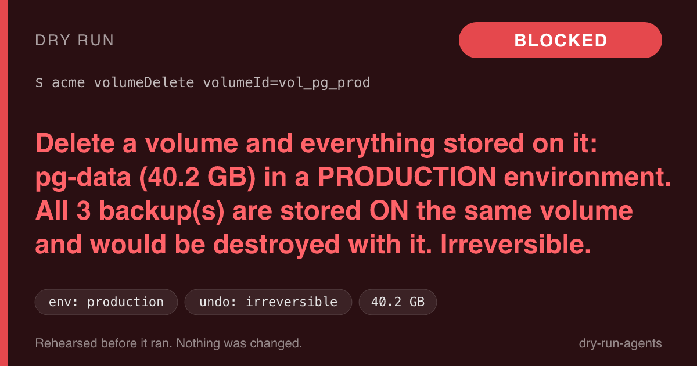

# Dry Run

**Rehearse anything before your agent does it.**

Dry Run is a flight simulator for AI agents. Before an agent deletes a volume, drops a table, force-pushes, applies Terraform or refunds 2,000 charges, it calls `dry_run`, sees the consequences, and stops if it should. It works with Claude Code, Codex, Cursor, Gemini CLI and anything else that speaks MCP.



> In April 2026 a coding agent found a cloud token in an unrelated file, assumed it was working in staging, and deleted a startup's production database and all its backups in nine seconds. Humans pause because they can picture the outcome. Agents need that as a tool.

## Install

```bash
npx dry-run-agents setup      # detects your agents, shows a diff, backs up configs, asks before applying
npx dry-run-agents doctor     # checks Docker, credentials, registration
npx dry-run-agents demo all   # four showcases, fully local, no accounts needed
```

Published on npm as [`dry-run-agents`](https://www.npmjs.com/package/dry-run-agents). To build from source instead: `npm install && npm run build && npm run bundle -w dry-run-agents`, then `node packages/cli/dist/dryrun.mjs setup`.

Requires Node 22+. Docker is optional but recommended (it enables Tier 3 sandbox rehearsal). Windows: use WSL2.

## What you get

| The agent is about to… | Dry Run tells it |
|---|---|
| `DELETE FROM orders` | "Removes **12,481** rows of `orders` and **12,481** dependent `order_items` (ON DELETE CASCADE). Irreversible. Add a `WHERE`." |
| delete a cloud volume | "Deletes `pg-data` (**40.2 GB**) in a **production** environment; all 3 backups are on the same volume; the token is account-wide." |
| `git push --force` | "Erases **3** remote commits by Priya Nair: `fix checkout rounding bug`, …" |
| refund 2,000 charges | "**USD 69,500** to 800 customers, **live mode**. Irreversible." |

Every report returns a **verdict**: `safe`, `confirm` or `block`, with the evidence for each claim, and a shareable report card.



## How it works

```
 agent ──dry_run(action)──▶ MCP server ──▶ simulator for that action type
                                              │
              ┌───────────────────────────────┼───────────────────────────────┐
              ▼                               ▼                               ▼
      Tier 1: static                 Tier 2: read-only               Tier 3: sandbox
      parse + classify               inspect the real system         run it on a disposable copy
      (SQL parser, shell             (GET-only HTTP, read-only       (Docker, no network, CPU/mem/
      tokenizer, op catalog)         Postgres session, git fetch     time limits; diff files/rows/
                                     into a throwaway repo)          schema before vs after)
              └───────────────────────────────┼───────────────────────────────┘
                                              ▼
                        findings ──▶ policy engine ──▶ Consequence Report
                                                       verdict · effects · reversibility
                                                       environment · blast radius · evidence
                                                       safer alternative · report card
```

Dry Run **reports; it never executes.** The agent still runs the real action, after the verdict.

### The guarantees, and how they are enforced

1. **It never changes a real system.** The HTTP client Dry Run hands to simulators has only `get` and a GraphQL-*query* method (mutations are rejected before sending). Postgres access goes through a gate that accepts a single `SELECT`/`EXPLAIN`/`SHOW`, in a server-side read-only session; `EXPLAIN ANALYZE` is refused. The untrusted statement is only ever executed inside a disposable, network-less container. Tests run every simulator against mock providers that record every request and fail on any non-GET.
2. **Unknown is not safe.** `safe` is reachable only if a simulator matched, Tier 1 positively classified the action as benign, nothing is unverified, no tier errored, and it is reversible. Unknown command, operation, provider, unparseable SQL, unreachable remote, missing credentials, Docker missing: all `confirm` at best. Property tests and a golden corpus of dangerous inputs enforce this.
3. **Local-first.** No telemetry, no uploads. Reports are written to `./.dryrun/reports/` (redacted). Secrets are masked in reports, cards, logs and errors; tests assert absence across stdout, stderr, JSON, saved files and SVG.
4. **Action content is untrusted.** Commands, SQL and payloads are parsed, not executed, except in the sandbox. MCP output wraps the report in an `<dryrun_report untrusted_strings="true">` envelope and tells the agent that strings in it are data.
5. **Evidence for every claim.** A report whose finding lacks evidence fails to build.

## Showcases

Run any with `dryrun demo <name>` (writes JSON, SVG and PNG cards to `./dryrun-demo-output/`).

| Demo | What happens | |
|---|---|---|
| `nine-second-deletion` | Mock cloud with a production Postgres volume and same-volume backups; an over-scoped token sits in `.env.local`. **Block**: production evidence, 40.2 GB, backup loss, token over-scope. |  |
| `missing-where` | `DELETE FROM orders` against a Docker Postgres (read-only role + throwaway rehearsal). All 12,481 rows, the cascade, then the scoped version. |  |
| `force-push` | Local git remote; a force push would erase a teammate's 3 commits. Names them. |  |
| `refund-storm` | Mock Stripe; a script would refund 2,000 live charges. Totals the money. |  |

## Using it

**From an agent (MCP):** tools `dry_run`, `explain_report`, `list_simulators`. `setup` also installs short instructions (a Claude Code skill and `CLAUDE.md` block, `AGENTS.md` for Codex, `GEMINI.md`, a Cursor rule with `--project`) telling the agent to call `dry_run` before risky actions and to obey the verdict.

**From the CLI:**

```bash
dryrun sql "DELETE FROM orders" --db-env DRYRUN_DATABASE_URL
dryrun shell "git push --force origin main"
dryrun tf plan.json                      # terraform show -json tfplan > plan.json
dryrun api railway volumeDelete --params '{"volumeId":"..."}'
dryrun saas stripe refund --params '{"charges":["ch_1","ch_2"]}' --credential-env STRIPE_API_KEY
dryrun saas slack chat.postMessage --params '{"channel":"C123","text":"<!channel> hi"}'
dryrun list                              # what can be rehearsed here, by tier
dryrun explain <report-id>               # plain language
```

Exit codes: `0` safe, `2` confirm, `3` block, `1` error. Add `--json` and `--card report.png`.

### What each simulator covers

| Simulator | Tier 1 | Tier 2 (read-only) | Tier 3 (sandbox) |
|---|---|---|---|
| **shell / git** | classify rm/mv/chmod/dd/force push/reset --hard/clean/publish/scripts/pipes/redirects; flags paths outside the project, `~/.ssh`, `/`; dynamic constructs ⇒ unverified | force push: fetches the remote branch into a throwaway repo, lists the exact commits and authors that would be lost | Docker, no network, read-only root fs, no capabilities; diffs files deleted/modified/created, and whether git can restore them |
| **postgres** | real parser; DROP, TRUNCATE, DELETE/UPDATE without WHERE, DROP COLUMN, CASCADE | exact affected rows from the statement's own `WHERE`, FK cascade counts, dependent views, table size, `EXPLAIN`, credential privileges | disposable Postgres loaded with the schema and a row sample; diffs row counts and schema |
| **terraform** | parses `terraform show -json`; every delete/replace; data-bearing resources; backups inside the same resource | — | — |
| **cloud_api** | operation catalog (Railway, Vercel, AWS, plus the reference mock) | resolves the target: size, production signals (name, tags, domains, traffic), whether backups survive, what the token can do | — |
| **saas** | Stripe, email, Slack, GitHub classification | Stripe amounts/customers/live-vs-test; Slack members/external sharing/@channel; GitHub stars/forks/open PRs/branch protection | — |

Honest status: Railway and Vercel *classification* comes from public API names; their Tier 2 resolvers are **experimental** (verified against the reference mock, not live APIs). AWS is classification-only; its targets are reported unverified, so AWS deletes are never `safe`. Email is Tier 1 only. See each catalog's `status` field.

### Verdict policy

Defaults live in `dryrun.config.json` (all optional):

```json
{ "thresholds": { "blockRows": 1000, "blockBytes": 1000000000, "blockMoney": 10000, "blockPeople": 1000, "confirmFiles": 10 },
  "blockUnknownEnvIrreversible": true,
  "productionHints": ["prod", "production", "live"] }
```

`block`: irreversible + critical in production; irreversible data loss where the environment cannot be confirmed as non-production; irreversible over a threshold; catastrophic commands (`rm -rf /`, `~`, `dd` to a device). An invalid config is an error, never a silent fallback.

## Credentials

Create **read-only** credentials for Dry Run and never reuse the agent's write credentials. See [docs/credentials.md](docs/credentials.md).

## FAQ

**Does Dry Run touch my systems?** No writes, by construction (see the guarantees). It does make read-only calls (GET requests, read-only SQL, a `git fetch` of the remote branch into a temp repo) using the read-only credentials you give it, and it lists every call in the report's evidence.

**Does anything leave my machine?** No telemetry or uploads. The only network traffic is the read-only calls to the systems you point it at, and Docker image pulls you run yourself.

**Can a malicious command or SQL hurt me while it is being rehearsed?** Untrusted text only ever runs inside a container with no network, no capabilities, `no-new-privileges`, a read-only root filesystem, CPU/memory/pid/time limits, and a throwaway *copy* of your project (symlinks are copied as links, never followed). Projects over the copy limit skip Tier 3 rather than mount the real directory. Review [docs/security.md](docs/security.md).

**What if Docker isn't installed?** Tier 3 is skipped, the report says so, and the verdict can never be `safe` for anything that needed it.

**What if Dry Run itself fails?** Errors become `confirm` with the reason in the report. If the MCP server is unavailable, the installed instructions tell the agent to treat that as `confirm`.

**Will the agent always call it?** No. Instructions are advisory. For enforcement, pair Dry Run with permission prompts or a Claude Code `PreToolUse` hook; Dry Run does not install one yet.

**Why not just `BEGIN … ROLLBACK`?** Triggers, locks and sequences can have real side effects. Dry Run never runs your statement on the real database.

## Contributing

See [CONTRIBUTING.md](CONTRIBUTING.md). Adding a provider is a JSON file plus a test.

## Limits (v1)

Reports only; it never executes for the agent. Postgres only. Windows via WSL. Sandbox rehearsals are approximations (no network, different OS tools, sampled data), and reports say where. Not a replacement for backups, least-privilege tokens or branch protection.

## License

Apache-2.0
